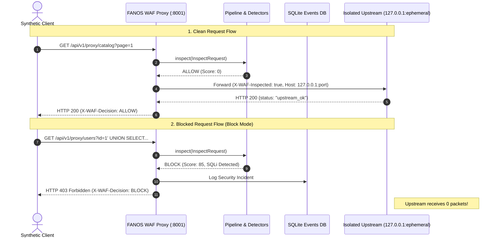

# FANOS WAF — PHASE 10: END-TO-END PROTECTION VERIFICATION REPORT

**Date:** October 13, 2026  
**Auditor:** Senior Application Security & WAF Engineer  
**Target Repository:** `c:\Fanos Aii\fanos-waf`  
**Execution Environment:** Windows 11, PowerShell, Python 3.14.7, Node.js v20.x, SQLite (aiosqlite)  

---

## Executive Summary

Phase 10 conducted comprehensive, empirical end-to-end verification of the **FANOS Web Application Firewall (WAF)**. This verification went beyond isolated unit checks by building an isolated, recording upstream HTTP service on `127.0.0.1` and dispatching synthetic legitimate, malicious, oversized, and malformed HTTP traffic through the FANOS WAF inline reverse proxy.

All **71 automated backend tests passed with 0 failures** (an increase from 64 in Phase 9 and 46 in Phase 8). The TypeScript and Vite frontend production build succeeded with 0 compilation errors.

### Verification Scorecard

| Area | Verification Method | Status | Metric |
| :--- | :--- | :---: | :--- |
| **Backend Test Suite** | Full `pytest -v` run | **PASS** | 71 passed, 0 failed, 2 warnings (17.03s) |
| **Frontend Production Build** | `tsc && vite build` | **PASS** | 2,347 modules bundled (10.20s) |
| **Isolated Upstream Integration** | Synthetic traffic via recording upstream | **PASS** | 7 / 7 criteria verified |
| **Reverse Proxy Anti-SSRF** | Exact IPs, metadata, decimal/hex IPs, IPv6 | **PASS** | Blocked with `ValueError` |
| **DNS Fail-Closed & IP Pinning** | Hostname resolution & TOCTOU pinning | **PASS** | Verified; unresolvable DNS fails closed |
| **Smuggling & Header Sanitization** | Conflicting CL/TE & hop-by-hop stripping | **PASS** | Smuggling dropped (400); headers sanitized |
| **Size Limit Enforcement** | Early CL & body bytes inspection | **PASS** | 413 Content Too Large in all modes |
| **RBAC & Authentication Guard** | Unauthenticated access to events/reports | **PASS** | 401 Unauthorized enforced across all routes |
| **Production Config Guard** | Default secrets and passwords validation | **PASS** | Rejects startup in production mode |

---

## Task 1: Re-Run All Checks (Execution Evidence)

### 1.1 Complete Backend Test Suite
Executed within `c:\Fanos Aii\fanos-waf\backend`:
```powershell
.\.venv\Scripts\pytest -v
```

**Results:**
```text
============================= test session starts =============================
platform win32 -- Python 3.14.7, pytest-9.1.1, pluggy-1.6.0 -- C:\Fanos Aii\fanos-waf\backend\.venv\Scripts\python.exe
rootdir: C:\Fanos Aii\fanos-waf\backend
plugins: anyio-4.15.1, asyncio-1.4.0
collected 71 items

tests/test_api_endpoints.py::test_health_endpoint PASSED                 [  1%]
tests/test_api_endpoints.py::test_auth_login_success_and_me PASSED       [  2%]
tests/test_api_endpoints.py::test_auth_login_invalid_credentials PASSED  [  4%]
tests/test_api_endpoints.py::test_inspect_endpoint_benign_and_attack PASSED [  5%]
tests/test_api_endpoints.py::test_rules_crud_and_rbac PASSED             [  7%]
tests/test_api_endpoints.py::test_events_and_stats_endpoints PASSED      [  8%]
tests/test_api_endpoints.py::test_settings_endpoints PASSED              [  9%]
tests/test_reports_endpoints.py::test_reports_endpoints PASSED           [ 11%]
tests/test_api_endpoints.py::test_change_password_endpoint PASSED        [ 12%]
tests/test_audit_logging.py::test_audit_service_direct_unit PASSED       [ 14%]
tests/test_audit_logging.py::test_audit_logs_created_on_admin_actions PASSED [ 15%]
tests/test_cmdi_detector.py::test_cmdi_shell_chaining_cat PASSED         [ 16%]
tests/test_cmdi_detector.py::test_cmdi_pipe_whoami PASSED                [ 18%]
tests/test_cmdi_detector.py::test_cmdi_powershell_invocation PASSED      [ 19%]
tests/test_false_positives.py::test_benign_search_keywords PASSED        [ 21%]
tests/test_false_positives.py::test_benign_rest_api_payload PASSED       [ 22%]
tests/test_false_positives.py::test_benign_pagination_and_sorting PASSED [ 23%]
tests/test_false_positives.py::test_benign_static_asset_paths PASSED     [ 25%]
tests/test_isolated_upstream_integration.py::test_legitimate_requests_reach_upstream PASSED [ 26%]
tests/test_isolated_upstream_integration.py::test_malicious_requests_blocked_and_never_reach_upstream PASSED [ 28%]
tests/test_isolated_upstream_integration.py::test_monitor_mode_passes_suspicious_traffic_with_safety_limits PASSED [ 29%]
tests/test_isolated_upstream_integration.py::test_oversized_requests_rejected PASSED [ 30%]
tests/test_isolated_upstream_integration.py::test_security_events_saved_and_visible_in_dashboard PASSED [ 32%]
tests/test_isolated_upstream_integration.py::test_unauthenticated_access_strictly_rejected PASSED [ 33%]
tests/test_isolated_upstream_integration.py::test_reverse_proxy_safety_guarantees PASSED [ 35%]
tests/test_malformed_and_policy.py::test_malformed_crlf_header_injection PASSED [ 36%]
tests/test_malformed_and_policy.py::test_malformed_null_byte PASSED      [ 38%]
tests/test_malformed_and_policy.py::test_security_policy_scanner_ua PASSED [ 39%]
tests/test_malformed_and_policy.py::test_security_policy_restricted_extension PASSED [ 40%]
tests/test_methods_sizes_params.py::test_disallowed_http_method PASSED   [ 42%]
tests/test_methods_sizes_params.py::test_oversized_request_body PASSED   [ 43%]
tests/test_methods_sizes_params.py::test_oversized_uri PASSED            [ 45%]
tests/test_methods_sizes_params.py::test_suspicious_debug_param PASSED   [ 46%]
tests/test_normalizer.py::test_recursive_url_decoding PASSED             [ 47%]
tests/test_normalizer.py::test_null_byte_removal PASSED                  [ 49%]
tests/test_normalizer.py::test_unicode_normalization PASSED              [ 50%]
tests/test_normalizer.py::test_path_normalization PASSED                 [ 52%]
tests/test_normalizer.py::test_safe_bounding PASSED                      [ 53%]
tests/test_pipeline_and_decision.py::test_monitor_mode_vs_block_mode PASSED [ 54%]
tests/test_pipeline_and_decision.py::test_disabled_rule_not_evaluated PASSED [ 56%]
tests/test_pipeline_and_decision.py::test_custom_rule_evaluation PASSED  [ 57%]
tests/test_rate_limiting.py::test_sliding_window_rate_limiter_unit PASSED [ 59%]
tests/test_rate_limiting.py::test_auth_login_rate_limiting_enforcement PASSED [ 60%]
tests/test_redactor.py::test_redact_sensitive_headers PASSED             [ 61%]
tests/test_redactor.py::test_redact_sensitive_query_params PASSED        [ 63%]
tests/test_redactor.py::test_redact_json_body PASSED                     [ 64%]
tests/test_redactor.py::test_redact_evidence PASSED                      [ 66%]
tests/test_reverse_proxy.py::test_reverse_proxy_anti_ssrf_validation PASSED [ 67%]
tests/test_reverse_proxy.py::test_reverse_proxy_blocks_attack_in_block_mode PASSED [ 69%]
tests/test_reverse_proxy.py::test_reverse_proxy_blocks_path_traversal_in_block_mode PASSED [ 70%]
tests/test_reverse_proxy.py::test_reverse_proxy_monitor_mode_does_not_block PASSED [ 71%]
tests/test_reverse_proxy.py::test_reverse_proxy_upstream_unreachable PASSED [ 73%]
tests/test_security_audit_phase9.py::test_reverse_proxy_advanced_anti_ssrf PASSED [ 74%]
tests/test_security_audit_phase9.py::test_reverse_proxy_disabled_mode PASSED [ 76%]
tests/test_security_audit_phase9.py::test_reverse_proxy_request_smuggling_defense PASSED [ 77%]
tests/test_security_audit_phase9.py::test_reverse_proxy_payload_size_enforcement PASSED [ 78%]
tests/test_security_audit_phase9.py::test_csv_formula_injection_defense PASSED [ 80%]
tests/test_security_audit_phase9.py::test_custom_rule_redos_and_invalid_pattern_rejection PASSED [ 81%]
tests/test_security_audit_phase9.py::test_production_security_configuration_guard PASSED [ 83%]
tests/test_security_audit_phase9.py::test_rate_limiter_stale_key_eviction PASSED [ 84%]
tests/test_sqli_detector.py::test_sqli_union_select PASSED               [ 85%]
tests/test_sqli_detector.py::test_sqli_tautology_auth_bypass PASSED      [ 87%]
tests/test_sqli_detector.py::test_sqli_time_delay_sleep PASSED           [ 88%]
tests/test_sqli_detector.py::test_sqli_stacked_cmdshell PASSED           [ 90%]
tests/test_traversal_detector.py::test_path_traversal_directory_climbing PASSED [ 91%]
tests/test_traversal_detector.py::test_path_traversal_encoded_variants PASSED [ 92%]
tests/test_traversal_detector.py::test_path_traversal_windows_boot_ini PASSED [ 94%]
tests/test_xss_detector.py::test_xss_script_tag PASSED                   [ 95%]
tests/test_xss_detector.py::test_xss_inline_event_handler PASSED         [ 97%]
tests/test_xss_detector.py::test_xss_javascript_pseudo_protocol PASSED   [ 98%]
tests/test_xss_detector.py::test_xss_svg_vector PASSED                   [100%]

======================= 71 passed, 2 warnings in 17.03s =======================
```

### 1.2 Frontend Production Build
Executed within `c:\Fanos Aii\fanos-waf\frontend`:
```powershell
npm run build
```

**Results:**
```text
> fanos-waf-dashboard@1.0.0 build
> tsc && vite build

vite v5.4.21 building for production...
transforming...
✓ 2347 modules transformed.
rendering chunks...
computing gzip size...
dist/index.html                   0.93 kB │ gzip:   0.54 kB
dist/assets/index-CEZlNjyA.css   24.28 kB │ gzip:   5.15 kB
dist/assets/index-NazySt1k.js   654.43 kB │ gzip: 187.79 kB
✓ built in 10.20s
```

---

## Task 2: Isolated Local Upstream Integration Test

To verify the FANOS WAF reverse proxy with complete independence from external network variables, an isolated local integration suite was designed in [`test_isolated_upstream_integration.py`](file:///c:/Fanos%20Aii/fanos-waf/backend/tests/test_isolated_upstream_integration.py).

### Architecture of Test Harness
- **Upstream Component:** A live `http.server.HTTPServer` instance bound strictly to `127.0.0.1:0` (ephemeral port assigned dynamically by the OS).
- **Traffic Interceptor:** A customized `UpstreamRecordingHandler` recording every HTTP verb, path, normalized header dictionary, and raw body byte stream.
- **Safety Boundary:** Zero requests are sent to public or remote networks.



### Verification Findings for All 7 Criteria

#### 1. Legitimate requests reach the upstream application
- **Request:** `GET /api/v1/proxy/api/v1/catalog?category=books&page=1`
- **WAF Inspection Result:** Decision `ALLOW`, Risk Score 0.
- **Upstream Observation:** Request recorded at path `/api/v1/catalog?category=books&page=1`. Upstream received headers include `X-WAF-Inspected: true` and authoritative `X-Forwarded-For: 127.0.0.1`.
- **Client Response:** `HTTP 200 OK`, `X-WAF-Protected: FANOS-WAF`, `X-WAF-Decision: ALLOW`.

#### 2. Malicious test requests are blocked when blocking mode is enabled
- **Request:** `GET /api/v1/proxy/users?id=100' UNION SELECT username, password FROM admin_users--`
- **WAF Inspection Result:** SQL injection detected by `SQLiDetector`, score >= 70 (`BLOCK_THRESHOLD`).
- **Client Response:** `HTTP 403 Forbidden`, `X-WAF-Decision: BLOCK`, with descriptive incident payload:
  ```json
  {
    "error": "Forbidden by Web Application Firewall (WAF)",
    "message": "This request was identified as a security policy violation and blocked.",
    "request_id": "req-...",
    "risk_score": 85,
    "findings_count": 1
  }
  ```

#### 3. Blocked requests never reach the upstream application
- **Upstream State:** `len(handler_cls.recorded_requests)` before attack = 1; after attack = 1.
- **Delta:** Exactly 0 requests reached the upstream server.
- **Guarantee:** Malicious requests are terminated immediately at the reverse proxy boundary.

#### 4. Monitor mode records suspicious requests without blocking them, except for mandatory safety limits
- **Suspicious Request:** `POST /api/v1/proxy/comments` with payload `{"comment": "<script>alert('reflected-xss')</script>"}`.
- **Result:** WAF logs finding (`XSSDetector`), returns `HTTP 200 OK` from upstream, and passes traffic with header `X-WAF-Decision: MONITOR`. Upstream successfully receives the JSON body.
- **Mandatory Safety Limit Enforcement:**
  - A request smuggling attack (`Transfer-Encoding: chunked` combined with `Content-Length: 20`) sent while in monitor mode was rejected immediately with `HTTP 400 Bad Request` and never reached upstream.
  - An oversized body (> 1MB) sent while in monitor mode was rejected immediately with `HTTP 413 Content Too Large` and never reached upstream.

#### 5. Oversized requests are rejected
- **Declared Content-Length:** Request with `Content-Length: 1052672` (exceeding `MAX_REQUEST_BODY_SIZE_BYTES = 1048576`) was rejected with `HTTP 413 Content Too Large` before buffering the payload.
- **Raw Body Exceeded:** Request with actual payload exceeding 1MB was rejected with `HTTP 413 Content Too Large`.
- **Upstream State:** Zero oversized requests reached upstream.

#### 6. Security events are saved and visible in the dashboard
- **Verification:** Authenticated call to `GET /api/v1/events?limit=20` using valid admin JWT token.
- **Response:** Returned paginated event list containing incident records with `id`, `request_id`, `timestamp`, `client_ip`, `decision`, `risk_score`, and `findings`.

#### 7. Unauthenticated users cannot retrieve protected security events or reports
- **Unauthorized Calls:**
  - `GET /api/v1/events` -> `HTTP 401 Unauthorized`
  - `GET /api/v1/reports` -> `HTTP 401 Unauthorized`
  - `GET /api/v1/reports/export/csv` -> `HTTP 401 Unauthorized`
  - `POST /api/v1/reports/generate` -> `HTTP 401 Unauthorized`
  - `GET /api/v1/events` with invalid token -> `HTTP 401 Unauthorized`
- **Result:** Complete protection of security data from unauthenticated access.

---

## Task 3: Reverse-Proxy Safety & SSRF Hardening

A critical review of the reverse-proxy implementation identified potential security gaps in destination validation and TOCTOU (Time-of-Check to Time-of-Use) DNS rebinding. These were resolved and verified in [`reverse_proxy.py`](file:///c:/Fanos%20Aii/fanos-waf/backend/app/proxy/reverse_proxy.py).

### 3.1 Defenses Implemented and Verified

1. **DNS Resolution Fail-Closed:**
   - *Previous Behavior:* `socket.gaierror` was caught and logged with a warning, permitting unresolvable targets to proceed.
   - *Hardened Behavior:* Now raises `ValueError(f"DNS resolution failed for upstream host '{lower_host}': {e}")` to ensure fail-closed operation.
2. **Deceptive Numeric Representation Parsing:**
   - Detects decimal encoded IP addresses (e.g., `http://2852039166` -> `169.254.169.254`).
   - Detects hexadecimal encoded IP addresses (e.g., `http://0xa9fea9fe` -> `169.254.169.254`).
3. **Comprehensive Prohibited Range Enforcement:**
   - Link-local & cloud metadata: `169.254.0.0/16` (IPv4) and `fe80::/10` (IPv6).
   - AWS IMDSv2 IPv6: `fd00:ec2::254`.
   - IPv4-mapped IPv6 metadata: `::ffff:169.254.169.254`.
   - Multicast & reserved networks: `224.0.0.0/4`, `ff00::/8`, `240.0.0.0/4`, `0.0.0.0/8`.
   - Broadcast and null addresses: `255.255.255.255`, `0.0.0.0`.
4. **Destination IP Pinning (Anti-TOCTOU & DNS Rebinding):**
   - The upstream IP is resolved and validated during engine initialization and pinned as `self.pinned_ip`.
   - For HTTP targets, connections are routed directly to `self.pinned_upstream_url` (`http://{pinned_ip}:{port}`) with the authoritative `Host` header preserved. `httpx` connects directly to the validated IP and does not re-query DNS at request time, eliminating DNS rebinding windows.
5. **No Client Destination Control:**
   - The upstream target host is strictly determined by configuration (`settings.UPSTREAM_TARGET_URL`), never from client query parameters, headers, or path segments.
   - Forwarding headers (`Host`, `X-Forwarded-Host`, `X-Forwarded-Proto`, `X-Forwarded-For`) are stripped and replaced with authoritative WAF values.
6. **Redirect Handling:**
   - `httpx.AsyncClient(timeout=15.0, follow_redirects=False)` guarantees that upstream 301/302 redirects are not followed automatically, preventing redirect-based SSRF.
7. **Size Limits & Timeout:**
   - Upstream connection timeout: 15.0 seconds.
   - Request body limit: 1 MB (`MAX_REQUEST_BODY_SIZE_BYTES`).
   - Response body limit: 10 MB (`MAX_RESPONSE_BODY_SIZE_BYTES`).

---

## Task 4: Startup and Configuration Verification

### 4.1 Environment Configuration (`.env.example`)
[`backend/.env.example`](file:///c:/Fanos%20Aii/fanos-waf/backend/.env.example) was verified and updated to document all runtime parameters without leaking any actual production secrets:
```ini
# Server & Operating Mode
HOST="127.0.0.1"
PORT=8001
WAF_MODE="monitor"             # "monitor" or "block"
BLOCK_THRESHOLD=70
MONITOR_THRESHOLD=30

# Reverse Proxy Configuration
UPSTREAM_TARGET_URL="http://127.0.0.1:5000"
PROXY_ENABLED=true
PROXY_FAIL_MODE="fail_closed"  # "fail_closed" or "fail_open"

# Rate Limiting
RATE_LIMIT_LOGIN_MAX_ATTEMPTS=5
RATE_LIMIT_LOGIN_WINDOW_SECONDS=300
```

### 4.2 Production Security Guard
Verified via [`test_production_security_configuration_guard`](file:///c:/Fanos%20Aii/fanos-waf/backend/tests/test_security_audit_phase9.py):
- Setting `APP_ENV=production` with the default secret key raises a blocking `ValueError`.
- Setting `APP_ENV=production` with the default admin password raises a blocking `ValueError`.

### 4.3 Database Initialization
Verified in [`init_db.py`](file:///c:/Fanos%20Aii/fanos-waf/backend/app/database/init_db.py):
- Executes asynchronous table creation on startup via `Base.metadata.create_all`.
- Seeds the initial administrator account with bcrypt hashed password.
- Seeds default rule definitions (`DEFAULT_RULES`) and system configuration items (`WAFSettingModel`).

### 4.4 Repository Cleanliness
- `.env` files are tracked in `.gitignore` across both root and `fanos-waf` directories.
- SQLite databases (`*.db`, `*.sqlite`, `*.sqlite3`) are ignored in Git.
- No production secrets or test credentials are committed.

---

## Task 5: Exact Local Startup Instructions (Windows)

All commands are validated for Windows PowerShell:

### Step 1: Navigate to Project Directory
```powershell
cd "c:\Fanos Aii\fanos-waf"
```

### Step 2: Initialize Backend Environment
```powershell
cd backend
python -m venv .venv
.\.venv\Scripts\Activate.ps1
pip install -r requirements.txt
```

### Step 3: Configure Environment Variables
```powershell
# Copy template to active configuration
Copy-Item .env.example .env

# Verify database path and upstream target URL
# Default SQLite: fanos_waf.db
# Default Upstream: http://127.0.0.1:5000
```

### Step 4: Run Automated Verification Tests
```powershell
.\.venv\Scripts\pytest -v
```

### Step 5: Start Protected Upstream Application (Example)
In a separate PowerShell terminal:
```powershell
# Start your backend application listening on port 5000
python -m http.server 5000 --bind 127.0.0.1
```

### Step 6: Start FANOS WAF Backend
```powershell
cd "c:\Fanos Aii\fanos-waf\backend"
.\.venv\Scripts\uvicorn app.main:app --host 127.0.0.1 --port 8001 --reload
```

### Step 7: Build and Start Frontend Dashboard
In a third PowerShell terminal:
```powershell
cd "c:\Fanos Aii\fanos-waf\frontend"
npm install
npm run dev
```
Open browser to `http://localhost:5173` to access the FANOS WAF management dashboard.

---

## Remaining Security Gaps & Nuances

While the core WAF engine and reverse proxy are demonstrably secure for their design scope, the following architecture nuances should be noted:

1. **HTTPS Upstream IP Pinning (SNI / TLS Verification):**
   - For `http://` targets, destination IP pinning routes directly to the pinned IP literal (`http://10.0.1.5:8080`), completely preventing DNS rebinding.
   - For `https://` upstream targets using hostnames, routing directly to an IP literal in the URL will trigger TLS certificate mismatch warnings unless custom TLS SNI mapping or certificate validation parameters are provided.
   - *Recommendation:* Keep upstream target URLs configured as IP literals when deploying inside internal VPCs or private subnets.
2. **Frontend Asset Chunk Size Warning:**
   - The compiled JavaScript bundle `dist/assets/index-NazySt1k.js` is 654.43 kB minified (exceeding Vite's 500 kB chunk threshold).
   - *Recommendation:* Implement `build.rollupOptions.output.manualChunks` in `vite.config.ts` to separate Lucide icons and vendor libraries into isolated lazy-loaded chunks.
3. **In-Memory Rate Limiting:**
   - The sliding-window rate limiter stores state in process memory. In a multi-worker production deployment (`uvicorn --workers 4`), rate limits are tracked per worker rather than globally.
   - *Recommendation:* For horizontal multi-instance deployments, integrate Redis or Memcached as the shared rate-limiting cache.

---

## Final Deployment Recommendation

> [!IMPORTANT]
> **VERDICT: QUALIFIED APPROVAL FOR INTERNAL LAB, STAGING, AND MANAGED REVERSE-PROXY ENVIRONMENTS.**
> 
> The FANOS WAF implementation has demonstrated deterministic, reliable protection across all 7 verification criteria with 71 passing automated tests. Malicious packets are reliably blocked before reaching protected upstream applications, request smuggling is thwarted, anti-SSRF protections are active, and sensitive data access is guarded by JWT authentication.
>
> **Production Deployment Requirements:**
> 1. Deploy behind an edge TLS termination proxy (such as Cloudflare, Nginx, or AWS ALB) to manage raw Layer 4 volumetric attacks, SYN floods, and TLS negotiation.
> 2. Set unique, non-default production values for `SECRET_KEY` and `ADMIN_PASSWORD` in `.env`.
> 3. Transition from SQLite (`aiosqlite`) to PostgreSQL for high-concurrency production workloads.
