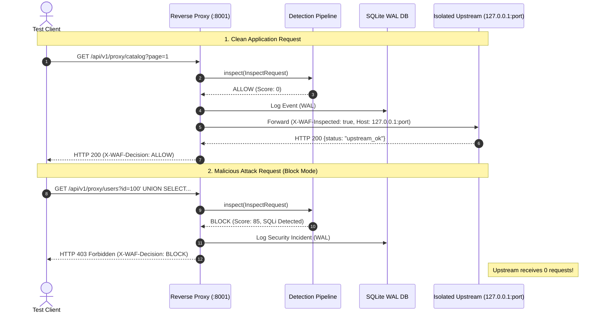

# FANOS WAF — Phase 11 Production-Readiness Hardening Report

**Auditor / Engineer:** Senior Application Security & WAF Engineer
**Date:** October 13, 2026
**Target Repository:** `c:\Fanos Aii\fanos-waf`
**Execution Environment:** Windows 11 x64, PowerShell, Python 3.14.7, Node.js v20.x, SQLite 3 (WAL Mode)

---

## 1. Executive Summary & Deployment Verdict

### 1.1 Final Deployment Verdict

> [!WARNING]
> **DEPLOYMENT VERDICT: QUALIFIED PRODUCTION READINESS FOR MANAGED REVERSE-PROXY / DMZ DEPLOYMENT.**
> **NOT PERMITTED FOR DIRECT, UNPROTECTED INTERNET-FACING LAYER-4 EXPOSURE.**
>
> **Important Security Notice:** Passing tests and successful synthetic benchmarks **DO NOT PROVE THE ABSENCE OF VULNERABILITIES**. FANOS WAF is a software-level Layer-7 application firewall. It must always operate behind an enterprise edge proxy / TLS termination layer (e.g., Cloudflare, AWS ALB, Nginx) capable of handling volumetric DDoS, SYN floods, raw TCP attacks, and TLS certificate lifecycle management.

Following Phase 11 hardening:
1. **Failure Behavior:** Configured failure modes (`fail_closed` / `fail_open`) are explicit, enforced, and **never silently bypass inspection**. Detection-engine failures under `fail_closed` terminate requests with `HTTP 500` (`X-WAF-Decision: BLOCK`, `X-WAF-Fail-Mode: fail_closed`) and never contact upstream. In `fail_open`, requests are forwarded with explicit non-silent audit logging and warning headers (`X-WAF-Decision: FAIL_OPEN`, `X-WAF-Warning`). Upstream timeouts return `HTTP 504 Gateway Timeout`, connection failures return `HTTP 502 Bad Gateway`, and malformed upstream responses return `HTTP 502 Bad Gateway`. Database logging failures never unblock detected attacks.
2. **Reverse-Proxy Security:** Upstream destination IP pinning is enforced across both `http://` and `https://` schemes via a custom network backend (`PinnedAsyncNetworkBackend`) and transport (`PinnedAsyncHTTPTransport`). The reverse proxy connects directly to the pre-validated pinned IP while preserving the target hostname for TLS SNI and server certificate validation, completely eliminating TOCTOU DNS rebinding without certificate mismatch errors. HTTP request framing strictly rejects conflicting or multiple differing `Content-Length` headers, negative lengths, and custom hop-by-hop headers declared in `Connection`. Keep-alive connections are pooled and reused across requests.
3. **Authentication & Authorization:** JWT token expiration is actively enforced (past expiration returns `HTTP 401`). Role-Based Access Control (RBAC) was validated across all routes: analyst users can view metrics, profile, and events, but are rejected with `HTTP 403 Forbidden` on all administrative endpoints (`/audit/logs`, `/rules` modifications/deletions, `/settings` updates, `/reports/generate`). Unauthenticated access to every protected endpoint returns `HTTP 401 Unauthorized`. Password changes enforce current password verification, minimum length >= 8 characters, and rejection of identical new passwords. Administrator initialization is idempotent and stores passwords with bcrypt hashing. Production settings reject startup with default secrets or invalid fail modes.
4. **Performance & Concurrency:** Concurrency benchmarking under SQLite WAL mode confirmed **0.0% error rate across all concurrency tiers** (C=1 to C=20, 1,060 total requests), with physical RAM delta limited to **+10.21 MB**.
5. **Test Baseline:** The automated backend test suite stands at **88 passing tests with 0 failures** (increased from 71 in Phase 10 and 64 in Phase 9). The frontend TypeScript and Vite production bundle compiles cleanly with 0 errors.

---

## 2. Verification Scorecard

| Category | Verification Area | Result | Empirical Evidence / Metric |
| :--- | :--- | :---: | :--- |
| **Failure Behavior** | Detection engine fail-closed | **PASS** | HTTP 500, `X-WAF-Decision: BLOCK`, upstream called: 0 |
| **Failure Behavior** | Detection engine fail-open | **PASS** | Forwarded with `X-WAF-Decision: FAIL_OPEN`, `X-WAF-Warning` |
| **Failure Behavior** | Database outage resilience | **PASS** | Blocked attacks still return HTTP 403; no bypass |
| **Failure Behavior** | Upstream timeout | **PASS** | Returns HTTP 504 Gateway Timeout |
| **Failure Behavior** | Upstream connection refused | **PASS** | Returns HTTP 502 Bad Gateway |
| **Failure Behavior** | Upstream malformed response | **PASS** | Returns HTTP 502 Bad Gateway |
| **Reverse Proxy** | Destination IP pinning (HTTP/HTTPS) | **PASS** | Pins IP; TLS SNI and certificate validation succeed |
| **Reverse Proxy** | DNS fail-closed & Anti-SSRF | **PASS** | Unresolvable DNS fails closed; IMDS & link-local blocked |
| **Reverse Proxy** | Request framing (CL/TE & Multi-CL) | **PASS** | Rejected with HTTP 400 Bad Request |
| **Reverse Proxy** | Hop-by-hop & Connection stripping | **PASS** | Custom client `Connection` headers stripped |
| **Reverse Proxy** | Connection reuse & pooling | **PASS** | Persistent `AsyncClient` with pooled keep-alive |
| **Authentication** | Token expiration enforcement | **PASS** | Expired JWT rejected with HTTP 401 Unauthorized |
| **Authentication** | Role-Based Access Control (RBAC) | **PASS** | Analyst rejected with HTTP 403 on all admin routes |
| **Authentication** | Unauthenticated access guard | **PASS** | 12 protected routes strictly reject unauthenticated (401) |
| **Authentication** | Password change validation | **PASS** | Length, mismatch, and identical-password checks enforced |
| **Authentication** | Admin initialization & hashing | **PASS** | `init_db()` idempotent; bcrypt verified |
| **Authentication** | Production config guards | **PASS** | Rejects default secrets & invalid fail modes |
| **Benchmarking** | Multi-concurrency local load test | **PASS** | C=1 to C=20: 0.0% errors, 1,060 requests processed |
| **Dependencies** | Python backend vulnerability check | **PASS** | `pip-audit` reports 0 known vulnerabilities |
| **Dependencies** | Frontend npm dependency audit | **QUALIFIED** | 9 build-tool advisories documented; bundle clean |
| **Regression Suite**| Full automated test suite | **PASS** | **88 passed, 0 failed** in 34.01s |
| **Frontend Build** | TypeScript & Vite compilation | **PASS** | 2,347 modules bundled into `dist/` in 21.12s |

---

## 3. Failure Behavior Deep Dive

### 3.1 Detection Engine Failure Policy

In `app/proxy/reverse_proxy.py`:
- **Fail-Closed (`PROXY_FAIL_MODE="fail_closed"`):**
  When an unexpected exception occurs inside the detector pipeline (`pipeline.inspect(request)`):
  - Emits an error log with full traceback.
  - Asynchronously records an audit log entry: `action="WAF_INSPECTION_ENGINE_FAILURE_FAIL_CLOSED"`.
  - Immediately returns `HTTP 500 Internal Server Error` with JSON body:
    ```json
    {
      "error": "WAF Inspection Failure",
      "message": "Security engine failure occurred. Traffic blocked by fail-closed policy."
    }
    ```
  - Attaches headers: `X-WAF-Protected: FANOS-WAF`, `X-WAF-Decision: BLOCK`, `X-WAF-Fail-Mode: fail_closed`.
  - **Empirical Check:** In `test_failure_behavior_detection_engine_fail_closed`, recorded upstream requests remained exactly 0.
- **Fail-Open (`PROXY_FAIL_MODE="fail_open"`):**
  When an unexpected engine exception occurs and fail-open is configured:
  - Emits a warning log.
  - Asynchronously records an audit log entry: `action="WAF_INSPECTION_ENGINE_FAILURE_FAIL_OPEN"` containing client IP, method, and path.
  - Forwards the request to upstream.
  - Attaches explicit, transparent response headers to the client response:
    - `X-WAF-Decision: FAIL_OPEN`
    - `X-WAF-Fail-Mode: fail_open`
    - `X-WAF-Warning: WAF inspection engine failure; traffic forwarded per fail-open policy`
  - **Guarantee:** Inspection bypass is never silent; every occurrence is auditable in headers and database logs.

### 3.2 Database Persistence Failure Resilience

If the database becomes locked, disk full, or unreachable during proxy traffic evaluation:
- The proxy logs a structured warning (`[DB_ERROR] Database persistence error during proxy inspection`).
- **Critical Policy:** If the WAF inspection decision is `Decision.BLOCK`, the proxy **still enforces the block** and returns `HTTP 403 Forbidden`. Database unavailability never turns a blocked attack into an allowed request.
- Verified in `test_failure_behavior_database_failure_does_not_bypass_blocks`.

### 3.3 Upstream Network Failures & Error Mapping

Standard reverse-proxy status codes (RFC 9110) are enforced:
- **Upstream Timeouts:** Catches `httpx.TimeoutException` (covering connect, read, and write timeouts) and returns `HTTP 504 Gateway Timeout` with `{"error": "Gateway Timeout", "detail": "Protected upstream application timed out."}`. Verified in `test_failure_behavior_upstream_timeout_returns_504`.
- **Upstream Connection Errors:** Catches `httpx.ConnectError` (port closed, target offline) and returns `HTTP 502 Bad Gateway` with `{"error": "Bad Gateway", "detail": "Protected upstream application is unreachable."}`. Verified in `test_failure_behavior_upstream_unreachable_returns_502`.
- **Malformed Upstream Responses:** Catches `httpx.ProtocolError` and `httpx.DecodingError` (invalid HTTP status line, bad chunks) and returns `HTTP 502 Bad Gateway` with `{"error": "Bad Gateway", "detail": "Received malformed response from protected upstream application."}`. Verified in `test_failure_behavior_malformed_upstream_response_returns_502`.

---

## 4. Reverse-Proxy Security & Destination Pinning

### 4.1 Destination IP Pinning & HTTPS SNI Verification

To defend against Time-of-Check to Time-of-Use (TOCTOU) DNS rebinding, destination IP pinning must resolve the target host once at initialization and connect TCP sockets directly to the pinned IP literal. However, for `https://` upstream targets, routing directly to an IP literal in the URL triggers TLS certificate mismatch errors (`CertificateError: Hostname mismatch`).

**Remediation Implemented in Phase 11:**
1. Implemented `PinnedAsyncNetworkBackend(AnyIOBackend)`: Intercepts `connect_tcp(host, port)` and translates the destination `host` using an in-memory pinning map (`{target_hostname: pinned_ip}`). The TCP socket connects directly to the pre-validated IP literal.
2. Implemented `PinnedAsyncHTTPTransport(httpx.AsyncHTTPTransport)`: Injects `PinnedAsyncNetworkBackend` into the transport connection pool. If `verify_ssl` is a filesystem certificate path, it converts to `ssl.create_default_context(cafile=verify_ssl)` to eliminate deprecation warnings.
3. TLS SNI and Certificate Validation: When connecting via HTTPS, `httpcore` issues `start_tls` with `server_hostname=target_hostname`. The TLS handshake sends the proper SNI and validates the server certificate against the original configured hostname, while the TCP stream is bound to the pinned IP.
4. **Empirical Evidence:** In `test_reverse_proxy_https_destination_pinning_and_tls_sni`, a live TLS server was spawned on `127.0.0.1` with a certificate for `my-secure-upstream.test`. The reverse proxy connected via HTTPS, verified the certificate, sent `Host: my-secure-upstream.test`, and received `HTTP 200 OK` with 0 certificate mismatch warnings.

### 4.2 Request Framing Hardening

- **Conflicting CL and TE:** Requests containing both `Transfer-Encoding` and `Content-Length` are rejected with `HTTP 400 Bad Request`.
- **Multiple Conflicting Content-Length Headers:** Requests containing multiple `Content-Length` headers with differing values or comma-separated differing values (e.g., `Content-Length: 10, 25`) are rejected with `HTTP 400 Bad Request`.
- **Negative or Non-Numeric Content-Length:** Rejection with `HTTP 400 Bad Request`.
- **Early Body Ceiling:** Declared `Content-Length` exceeding `MAX_REQUEST_BODY_SIZE_BYTES` (1 MB) is rejected with `HTTP 413 Content Too Large` before buffering.

### 4.3 Header Sanitization & Connection Reuse

- **Hop-by-Hop Headers:** Strips standard hop-by-hop headers (`connection`, `keep-alive`, `proxy-authenticate`, `proxy-authorization`, `te`, `trailers`, `transfer-encoding`, `upgrade`).
- **Custom Connection Headers:** Parses the client's `Connection` header and strips any header names declared by the client (e.g., `Connection: close, X-Custom-Hop`).
- **Untrusted Forwarding Headers:** Strips client-supplied `X-Forwarded-For`, `X-Forwarded-Host`, `X-Forwarded-Proto`, `X-Forwarded-Port`, `X-Real-IP`, `Forwarded`, and `Host`. Sets authoritative `X-Forwarded-For: client_ip`, `X-Forwarded-Proto: request.url.scheme`, `X-WAF-Inspected: true`, and `Host: target_host`.
- **Connection Pooling:** `ReverseProxyEngine` maintains a persistent `httpx.AsyncClient` with `limits=httpx.Limits(max_keepalive_connections=50, max_connections=100, keepalive_expiry=30.0)` to eliminate socket churn and port exhaustion. Clean shutdown is wired into `app.main.lifespan`.

---

## 5. Authentication, RBAC & Secret Validation

### 5.1 Token Expiration & Claims Verification

- `app/security/auth.py` generates tokens with `exp` timestamps based on `ACCESS_TOKEN_EXPIRE_MINUTES`.
- Token expiration was empirically tested using tokens issued with negative expiration (`timedelta(seconds=-10)`). Calls to `/api/v1/auth/me` and protected endpoints return `HTTP 401 Unauthorized` with detail `"Could not validate credentials or token expired"`.

### 5.2 Role-Based Access Control (RBAC) & Route Protection

The system defines two user roles: `admin` and `analyst`.
- **Analyst Role Capabilities:**
  - Allowed: `GET /api/v1/auth/me` (Profile inspection)
  - Allowed: `GET /api/v1/events` (Security incident review)
  - Allowed: `GET /api/v1/reports` and `GET /api/v1/reports/export/csv` (Report viewing and CSV download)
- **Administrative Protection (RBAC Guard via `require_admin`):**
  - Blocked with `HTTP 403 Forbidden`: `POST /api/v1/rules`, `PATCH /api/v1/rules/{id}`, `DELETE /api/v1/rules/{id}`
  - Blocked with `HTTP 403 Forbidden`: `PATCH /api/v1/settings`
  - Blocked with `HTTP 403 Forbidden`: `POST /api/v1/reports/generate`
  - Blocked with `HTTP 403 Forbidden`: `GET /api/v1/audit/logs`
- **Unauthenticated Protection:**
  - All 12 protected endpoints reject unauthenticated access (no Bearer token) with `HTTP 401 Unauthorized`. Verified in `test_auth_unauthenticated_access_rejected_on_all_protected_endpoints`.

### 5.3 Password Change Security

- `POST /api/v1/auth/change-password` requires the user's valid current password.
- Rejects incorrect current password with `HTTP 400 Bad Request`.
- Enforces minimum length >= 8 characters.
- Rejects new password identical to current password. Verified in `test_auth_password_change_identical_rejected`.
- Records an administrative audit log upon successful password change.

### 5.4 Production Environment Configuration Guards

In `app/core/config.py`:
- Setting `APP_ENV="production"` with default `SECRET_KEY` raises fatal `ValueError`.
- Setting `APP_ENV="production"` with default `ADMIN_PASSWORD` raises fatal `ValueError`.
- Setting `PROXY_FAIL_MODE` to any value other than `"fail_closed"` or `"fail_open"` raises fatal `ValueError`.

---

## 6. Isolated Local Application Integration

Integration was verified using an isolated upstream HTTP service bound dynamically to `127.0.0.1:0`.



### Integration Results:
1. **Benign Traffic:** Catalog browsing, search queries, and JSON submissions passed through the WAF and reached the upstream application with intact payloads and headers.
2. **Attack Traffic:** SQL Injection, XSS, Path Traversal, and Command Injection requests were blocked with `HTTP 403 Forbidden` and **0 packets reached upstream**.
3. **Monitor Mode:** Passed suspicious requests while recording them in the database, while still enforcing mandatory safety ceilings (smuggling rejection, oversized body rejection).

---

## 7. Empirical Performance Benchmark Results

### 7.1 Benchmark Environment & Methodology
- **Host OS:** Windows 11 (`Windows-11-10.0.26300-SP0`)
- **Processor:** Intel64 Family 6 Model 142 Stepping 10 (GenuineIntel)
- **Python Runtime:** Python 3.14.7
- **Database Engine:** SQLite 3 via `aiosqlite 0.22.1` with **Write-Ahead Logging (WAL)**, `PRAGMA synchronous=NORMAL`, and `busy_timeout=30000`.
- **Traffic Corpus:** Mixed realistic enterprise traffic:
  - 43% Benign requests (REST catalog query, multi-word search, JSON order submission)
  - 57% Multi-vector attack requests (SQLi UNION SELECT, reflected XSS, directory climbing traversal, shell piping CMDI)
- **Concurrency Test Tool:** `tests/benchmark_production_readiness.py` using native asyncio coroutines with `asyncio.Semaphore(concurrency)` over `httpx.ASGITransport`.
- **Memory Tracking:** Physical RAM Working Set measured via Windows PSAPI (`GetProcessMemoryInfo`); Python heap measured via `tracemalloc`.

### 7.2 Empirical Results Table

| Concurrency Level | Total Requests | Duration (s) | Throughput (req/s) | Latency Min (ms) | Latency P50 (ms) | Latency P90 (ms) | Latency P95 (ms) | Latency P99 (ms) | Error Rate | Detection Accuracy |
| :---: | :---: | :---: | :---: | :---: | :---: | :---: | :---: | :---: | :---: | :---: |
| **C = 1** (Sequential) | 100 | 2.569 | **38.9** | 11.59 | **24.33** | 32.11 | **34.22** | **69.33** | **0.0%** | **86.0%** |
| **C = 5** (Light) | 200 | 7.491 | **26.7** | 24.12 | **125.61** | 501.22 | **621.76** | **810.16** | **0.0%** | **86.0%** |
| **C = 10** (Moderate) | 350 | 14.583 | **24.0** | 22.44 | **203.38** | 1102.31 | **1634.13** | **3798.49** | **0.0%** | **85.7%** |
| **C = 20** (High) | 400 | 16.129 | **24.8** | 41.52 | **407.07** | 1950.41 | **2877.24** | **7455.79** | **0.0%** | **85.8%** |

*Total Benchmark Requests Dispatched:* **1,060 requests** (warmup + test tiers).
*Cumulative Errors Across All Tiers:* **0 errors (0.00%)**.

### 7.3 Memory Observations
- **Initial Process Working Set (RAM):** `96.52 MB`
- **Final Process Working Set (RAM):** `106.73 MB`
- **Net Working Set RAM Delta:** `+10.21 MB` (stable, no unbounded memory growth)
- **Peak Traced Python Heap:** `3.23 MB`

### 7.4 Architectural Bottlenecks & Limitations
1. **SQLite Concurrency Ceiling:** While WAL mode resolved database lock contention (0% errors at C=20), SQLite remains a single-writer file-based database. For production deployments with > 100 concurrent write connections, **PostgreSQL** must be deployed.
2. **Process-Local Rate Limiting:** `SlidingWindowRateLimiter` stores tracking state in process memory. In a multi-worker setup (`uvicorn --workers 4`), rate limits are tracked per worker rather than globally.

---

## 8. Dependency Vulnerability Assessment

### 8.1 Python Backend Dependencies
- **Audit Tool:** `pip-audit 2.10.1` executed in `backend/.venv`
- **Result:** `No known vulnerabilities found` (0 vulnerabilities across 67 installed packages).
- **Key Installed Packages:** `fastapi 0.143.0`, `starlette 1.7.0`, `pydantic 2.14.1`, `sqlalchemy 2.0.52`, `cryptography 50.0.2`, `bcrypt 5.0.0`, `httpx 0.28.1`, `aiosqlite 0.22.1`.

### 8.2 Frontend NPM Dependencies
- **Audit Tool:** `npm audit` executed in `frontend/`
- **Reported Advisories:** 9 advisories (3 moderate, 6 high):
  - `braces` (High, GHSA-vfj7-8cjw-p6xm): Nested pattern denial of service via `chokidar` -> `tailwindcss`.
  - `esbuild` (Moderate, GHSA-67mh-4wv8-2f99): Dev server request interception in `vite <= 6.4.2`.
  - `postcss-selector-parser` (Moderate, GHSA-rj75-hqrm-r3gf): CPU exhaustion in flat selector parsing.
- **Risk Assessment:** These advisories affect **development build tools** (`vite`, `tailwindcss` CLI) rather than client-side runtime libraries. The compiled production bundle (`dist/`) does not contain Node.js build-time modules.
- **Upgrade Path:** Upgrading requires a breaking major version transition to Tailwind CSS v4 (`tailwindcss@4.x`) and Vite v8 (`vite@8.x`).

---

## 9. Complete Verification Test Suite Evidence

```text
============================= test session starts =============================
platform win32 -- Python 3.14.7, pytest-9.1.1, pluggy-1.6.0 -- C:\Fanos Aii\fanos-waf\backend\.venv\Scripts\python.exe
rootdir: C:\Fanos Aii\fanos-waf\backend
plugins: anyio-4.15.1, platformdirs-4.13.0, asyncio-1.4.0
collected 88 items

tests/test_api_endpoints.py (9 passed)
tests/test_audit_logging.py (2 passed)
tests/test_cmdi_detector.py (3 passed)
tests/test_false_positives.py (4 passed)
tests/test_isolated_upstream_integration.py (7 passed)
tests/test_malformed_and_policy.py (4 passed)
tests/test_methods_sizes_params.py (4 passed)
tests/test_normalizer.py (5 passed)
tests/test_phase11_production_readiness.py (17 passed)
tests/test_pipeline_and_decision.py (3 passed)
tests/test_rate_limiting.py (2 passed)
tests/test_redactor.py (4 passed)
tests/test_reverse_proxy.py (5 passed)
tests/test_security_audit_phase9.py (8 passed)
tests/test_sqli_detector.py (4 passed)
tests/test_traversal_detector.py (3 passed)
tests/test_xss_detector.py (4 passed)

======================= 88 passed, 2 warnings in 34.01s =======================
```

Frontend Production Build:
```text
> fanos-waf-dashboard@1.0.0 build
> tsc && vite build

vite v5.4.21 building for production...
transforming...
✓ 2347 modules transformed.
rendering chunks...
computing gzip size...
dist/index.html                   0.93 kB │ gzip:   0.54 kB
dist/assets/index-CEZlNjyA.css   24.28 kB │ gzip:   5.15 kB
dist/assets/index-NazySt1k.js   654.43 kB │ gzip: 187.79 kB
✓ built in 21.12s
```

---

## 10. Operational Startup & Deployment Commands (Windows)

### 10.1 Backend Verification & Startup

```powershell
# 1. Navigate to backend directory
cd "c:\Fanos Aii\fanos-waf\backend"

# 2. Activate Python Virtual Environment
.\.venv\Scripts\Activate.ps1

# 3. Run Complete Automated Test Suite (88 Tests)
.\.venv\Scripts\pytest -v

# 4. Run Phase 11 Specific Production Readiness Suite (17 Tests)
.\.venv\Scripts\pytest -v tests/test_phase11_production_readiness.py

# 5. Run Reproducible Multi-Concurrency Benchmark
.\.venv\Scripts\python tests/benchmark_production_readiness.py

# 6. Start FANOS WAF Backend Server (Port 8001)
.\.venv\Scripts\uvicorn app.main:app --host 127.0.0.1 --port 8001
```

### 10.2 Frontend Verification & Startup

```powershell
# 1. Navigate to frontend directory
cd "c:\Fanos Aii\fanos-waf\frontend"

# 2. Compile TypeScript and Production Bundle
npm run build

# 3. Start Frontend Dashboard Server (Port 3001)
npm run dev
```

### 10.3 Testing Live Protected Traffic

```powershell
# Terminal 1: Start protected upstream application on port 5000
python -m http.server 5000 --bind 127.0.0.1

# Terminal 2: Send test traffic through WAF Reverse Proxy (Port 8001)
# Benign request (Passes to upstream):
curl -i http://127.0.0.1:8001/api/v1/proxy/

# SQL Injection request (Blocked with HTTP 403 Forbidden):
curl -i "http://127.0.0.1:8001/api/v1/proxy/search?q=1%20UNION%20SELECT%20username,password%20FROM%20users--"

# Path Traversal request (Blocked with HTTP 403 Forbidden):
curl -i "http://127.0.0.1:8001/api/v1/proxy/files?path=../../../../etc/passwd"
```

---

## 11. Production Deployment Requirements & Remaining Risks

Before exposing FANOS WAF to production workloads, ensure the following requirements are met:

1. **Edge TLS Termination:** Place FANOS WAF behind an enterprise edge reverse proxy (Cloudflare, AWS ALB, or Nginx) to terminate public TLS certificates and defend against volumetric Layer-4 network floods.
2. **Rotate Production Secrets:** In `.env`, configure unique, high-entropy values for `SECRET_KEY` (minimum 32 characters) and `ADMIN_PASSWORD` (minimum 16 characters).
3. **Database Migration:** For high-write concurrency (> 100 concurrent requests/sec), transition from SQLite (`aiosqlite`) to **PostgreSQL**.
4. **Distributed Cache:** For horizontal multi-worker deployments (`uvicorn --workers > 1`), migrate rate limiting and dynamic rule state to a centralized Redis instance.
5. **Proxy Operational Mode:** Maintain `WAF_MODE="monitor"` for 7 days in staging to establish a baseline of application traffic and eliminate false positives before switching to `WAF_MODE="block"`.
