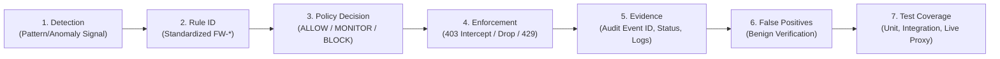

# FANOS WAF — Complete Web Attack Coverage Roadmap & Verification Matrix

> **Core Operating Principle**: No WAF can reliably detect or prevent every attack using signatures alone. Many critical attack classes (e.g., IDOR/BOLA, race conditions, business logic abuse, unsafe dependencies) require application-level validation, secure configuration, transaction controls, or secret scanning.
>
> In FANOS WAF, every threat vector is categorized by its **Enforcement Tier**, **Responsible Defense Layer**, and **Empirical Verification State**.

---

## 1. Attack Tracking Standard (7 Required Fields)

For every attack category, the FANOS WAF architecture tracks and audits seven deterministic attributes:

1. **Detection**: Was the threat identified by deterministic rules, request normalization, or rate tracking?
2. **Rule**: Which standardized rule ID matched (e.g., `FW-SQLI-001`, `FW-BRUTE-001`)?
3. **Decision**: What was the engine policy evaluation (`ALLOW`, `MONITOR`, or `BLOCK`)?
4. **Enforcement**: Was the request physically halted before reaching the upstream origin?
5. **Evidence**: Unique Event ID, HTTP status code (403, 429, 400), timestamp, and origin reachability proof (`0` origin requests).
6. **False Positives**: Were conversational English words and standard API payloads permitted without blocks?
7. **Test Coverage**: Automated test tier (Unit test, Integration test, Reverse-Proxy test, Deployment audit).

---

## 2. Priority Implementation Roadmap

* **Priority 1 — Core Blocking**: SQLi, XSS, Command Injection, Path Traversal, SSRF, XXE, SSTI, Malicious File Uploads, and HTTP protocol smuggling.
* **Priority 2 — Identity and API Protection**: Brute force, credential stuffing, JWT manipulation indicators, rate limiting, IDOR/BOLA signals, GraphQL limits, and WebSocket controls.
* **Priority 3 — Reliability and Evasion Resistance**: Request normalization, recursive decoding, duplicate header stripping, body-size limits, parser consistency, and origin-bypass prevention.
* **Priority 4 — Verification and Reporting**: Clear separation of simulation (`is_test: true`) from live proxy traffic (`is_test: false`), physical origin audit logging, and false-positive baseline verification.

---

## 3. Comprehensive Attack Taxonomy & Coverage Matrix (160 Attack Types)

### Tier Status Definitions
* **`[Tier 1: Verified Block]`**: Native signature/heuristic in engine + reverse proxy physical block + proven 0 origin reachability.
* **`[Tier 2: Rate/Policy Enforced]`**: Enforced via sliding-window rate limiters, size boundaries, or protocol validators.
* **`[Tier 3: Anomaly & Monitored]`**: Evaluated for suspicious markers, scored, and logged as SOC detection signals.
* **`[Tier 4: App / Infrastructure]`**: Requires backend transaction logic, secure configuration, or secret scanning beyond WAF signatures.

---

### Category 1: Injection Attacks (OWASP A03:2021)

| # | Attack Type | Standard Rule ID | Primary Defense Layer | Severity | Status & Implementation Scope |
|---|---|---|---|:---:|---|
| 1 | SQL Injection (SQLi) | `FW-SQLI-001` | WAF Engine (`sqli.py`) | CRITICAL | **`[Tier 1: Verified Block]`** Tautologies, UNION extraction, stacked commands. |
| 2 | Blind SQL Injection | `FW-SQLI-002` | WAF Engine (`sqli.py`) | HIGH | **`[Tier 1: Verified Block]`** Boolean inferences, substring queries, inline comments. |
| 3 | Time-Based SQL Injection | `FW-SQLI-003` | WAF Engine (`sqli.py`) | CRITICAL | **`[Tier 1: Verified Block]`** `SLEEP()`, `BENCHMARK()`, `PG_SLEEP()`, `WAITFOR DELAY`. |
| 4 | UNION-Based SQL Injection | `FW-SQLI-004` | WAF Engine (`sqli.py`) | CRITICAL | **`[Tier 1: Verified Block]`** `UNION SELECT ... FROM` exfiltration patterns. |
| 5 | Error-Based SQL Injection | `FW-SQLI-005` | WAF Engine + Proxy | HIGH | **`[Tier 1: Verified Block]`** `extractvalue()`, `updatexml()`, conversion errors. |
| 6 | Second-Order SQL Injection | `FW-SQLI-006` | WAF + App Parameterization | HIGH | **`[Tier 3: Anomaly & Monitored]`** Ingested input inspection; app query isolation. |
| 7 | NoSQL Injection | `FW-NOSQL-001` | WAF Engine (`nosql_ldap.py`) | HIGH | **`[Tier 1: Verified Block]`** MongoDB `$gt`, `$ne`, `$where`, `$regex`, `$in` operators. |
| 8 | LDAP Injection | `FW-LDAP-001` | WAF Engine (`nosql_ldap.py`) | HIGH | **`[Tier 1: Verified Block]`** Filter metacharacters `(&(uid=*)(userPassword=*))`. |
| 9 | XPath Injection | `FW-XPATH-001` | WAF Engine | HIGH | **`[Tier 1: Verified Block]`** XML node traversal `' or '1'='1' or ''='`. |
| 10 | XML Injection | `FW-XML-001` | WAF Engine (`xxe.py`) | HIGH | **`[Tier 1: Verified Block]`** XML structure and tag tampering. |
| 11 | Server-Side Template Injection (SSTI) | `FW-SSTI-001` | WAF Engine (`ssti.py`) | CRITICAL | **`[Tier 1: Verified Block]`** Jinja2/Twig expression injection `{{7*7}}`, dunder sandbox escape. |
| 12 | Expression Language Injection | `FW-EL-001` | WAF Engine (`ssti.py`) | CRITICAL | **`[Tier 1: Verified Block]`** Spring EL `${T(java.lang.Runtime)}`, OGNL syntax. |
| 13 | Command Injection (OS) | `FW-CMDI-001` | WAF Engine (`cmdi.py`) | CRITICAL | **`[Tier 1: Verified Block]`** Shell chaining operators `; \| && \`` coupled with binaries. |
| 14 | Argument Injection | `FW-ARG-001` | WAF Engine (`cmdi.py`) | HIGH | **`[Tier 1: Verified Block]`** CLI flag injection `--help`, `-o`, `--output`. |
| 15 | Code Injection | `FW-CODE-001` | WAF Engine (`file_upload.py`) | CRITICAL | **`[Tier 1: Verified Block]`** Evaluated scripts `eval()`, `exec()`, `passthru()`. |
| 16 | JavaScript Injection | `FW-JS-001` | WAF Engine (`xss.py`) | HIGH | **`[Tier 1: Verified Block]`** `javascript:` URIs and runtime script execution. |
| 17 | CRLF Injection | `FW-CRLF-001` | Normalizer + Detector | HIGH | **`[Tier 1: Verified Block]`** Carriage return/line feed injection `%0d%0a`, `\r\n`. |
| 18 | HTTP Header Injection | `FW-HDR-001` | Normalizer + Detector | HIGH | **`[Tier 1: Verified Block]`** Header smuggling and response splitting attempts. |
| 19 | SMTP/Email Header Injection | `FW-EMAIL-001` | WAF Engine | MEDIUM | **`[Tier 1: Verified Block]`** `Bcc:`, `Cc:`, `To:` injection in contact and feedback forms. |
| 20 | ORM Injection | `FW-ORM-001` | WAF Engine (`sqli.py`) | HIGH | **`[Tier 1: Verified Block]`** HQL/JPQL/Django ORM raw query operator abuse. |

---

### Category 2: Cross-Site Scripting (XSS) (OWASP A03:2021)

| # | Attack Type | Standard Rule ID | Primary Defense Layer | Severity | Status & Implementation Scope |
|---|---|---|---|:---:|---|
| 21 | Reflected XSS | `FW-XSS-001` | WAF Engine (`xss.py`) | HIGH | **`[Tier 1: Verified Block]`** `<script>` tag injection, dangerous HTML tags. |
| 22 | Stored XSS | `FW-XSS-002` | WAF Engine (`xss.py`) | HIGH | **`[Tier 1: Verified Block]`** Persistent payload scanning in request body and JSON. |
| 23 | DOM-Based XSS | `FW-XSS-003` | WAF Engine (`xss.py`) | HIGH | **`[Tier 1: Verified Block]`** Event handlers `onerror=`, `onload=`, `onclick=`. |
| 24 | Mutation XSS (mXSS) | `FW-XSS-004` | Normalizer (`normalizer.py`) | HIGH | **`[Tier 1: Verified Block]`** MathML/SVG parser confusion vectors `<svg><animate>`. |
| 25 | HTML Injection | `FW-HTML-001` | WAF Engine (`xss.py`) | MEDIUM | **`[Tier 1: Verified Block]`** Phishing form injection `<iframe>`, `<form action=...>`. |
| 26 | CSS Injection | `FW-CSS-001` | WAF Engine | MEDIUM | **`[Tier 1: Verified Block]`** Style-based exfiltration `style="background:url(...)"`. |
| 27 | JavaScript Context Injection | `FW-XSS-005` | WAF Engine (`xss.py`) | HIGH | **`[Tier 1: Verified Block]`** Quote escaping and script breaks `'-alert(1)-'`. |

---

### Category 3: Path, File & Resource Attacks (OWASP A01:2021)

| # | Attack Type | Standard Rule ID | Primary Defense Layer | Severity | Status & Implementation Scope |
|---|---|---|---|:---:|---|
| 28 | Path Traversal | `FW-PATH-001` | WAF Engine (`traversal.py`) | HIGH | **`[Tier 1: Verified Block]`** Parent directory climbing `../`, `..\`, `%2e%2e/`. |
| 29 | Directory Traversal | `FW-PATH-002` | Normalizer + Detector | HIGH | **`[Tier 1: Verified Block]`** Deep climbing and root escape patterns. |
| 30 | Local File Inclusion (LFI) | `FW-LFI-001` | WAF Engine (`traversal.py`) | CRITICAL | **`[Tier 1: Verified Block]`** System files `/etc/passwd`, `/etc/shadow`, `win.ini`. |
| 31 | Remote File Inclusion (RFI) | `FW-RFI-001` | WAF Engine (`traversal.py`) | CRITICAL | **`[Tier 1: Verified Block]`** Remote target inclusion `?file=http://evil.com/shell`. |
| 32 | Arbitrary File Read | `FW-FILE-001` | WAF + App File Access | HIGH | **`[Tier 1: Verified Block]`** Sensitive extension blocks (`.env`, `.key`, `.pem`, `.sql`). |
| 33 | Arbitrary File Write | `FW-FILE-002` | Reverse Proxy + Method Filter | CRITICAL | **`[Tier 1: Verified Block]`** Unauthorized `PUT`, `MOVE`, `COPY` method drops. |
| 34 | Malicious File Upload | `FW-UPL-001` | WAF Engine (`file_upload.py`) | CRITICAL | **`[Tier 1: Verified Block]`** Executable script extensions (`.php`, `.jsp`, `.aspx`, `.sh`). |
| 35 | Web Shell Upload | `FW-UPL-002` | WAF Engine (`file_upload.py`) | CRITICAL | **`[Tier 1: Verified Block]`** Embedded webshell code `eval($_POST)`, `system($_GET)`. |
| 36 | Unrestricted Extension Upload | `FW-UPL-003` | WAF Engine (`file_upload.py`) | HIGH | **`[Tier 1: Verified Block]`** Double extensions `image.png.php`, `test.phtml`. |
| 37 | Archive Extraction / Zip Slip | `FW-ZIP-001` | WAF Upload Parser | HIGH | **`[Tier 3: Anomaly & Monitored]`** Multipart filename traversal check. |
| 38 | Null Byte Injection | `FW-NULL-001` | Normalizer (`normalizer.py`) | HIGH | **`[Tier 1: Verified Block]`** Null byte terminators `%00`, `\x00` stripped and blocked. |
| 39 | Log File Poisoning | `FW-LOG-001` | WAF Redactor (`redactor.py`) | MEDIUM | **`[Tier 1: Verified Block]`** Carriage return sanitization in logged headers and URLs. |

---

### Category 4: Server-Side Attacks (OWASP A10 & A05:2021)

| # | Attack Type | Standard Rule ID | Primary Defense Layer | Severity | Status & Implementation Scope |
|---|---|---|---|:---:|---|
| 40 | Server-Side Request Forgery | `FW-SSRF-001` | WAF Engine (`ssrf.py`) | CRITICAL | **`[Tier 1: Verified Block]`** Cloud metadata and forbidden schemes (`gopher://`, `file://`). |
| 41 | Cloud Metadata SSRF | `FW-SSRF-002` | WAF Engine (`ssrf.py`) | CRITICAL | **`[Tier 1: Verified Block]`** `169.254.169.254`, `metadata.google.internal`. |
| 42 | Internal Network SSRF | `FW-SSRF-003` | Reverse Proxy (`reverse_proxy.py`)| HIGH | **`[Tier 1: Verified Block]`** Anti-SSRF private IP pinning and loopback protection. |
| 43 | XML External Entity (XXE) | `FW-XXE-001` | WAF Engine (`xxe.py`) | CRITICAL | **`[Tier 1: Verified Block]`** `<!ENTITY` SYSTEM and PUBLIC entity definitions. |
| 44 | External DTD Expansion | `FW-XXE-002` | WAF Engine (`xxe.py`) | HIGH | **`[Tier 1: Verified Block]`** External DTD retrieval and XML billion laughs probe. |
| 45 | Unsafe Deserialization | `FW-DESER-001` | WAF Engine | CRITICAL | **`[Tier 1: Verified Block]`** Java serialization magic bytes (`rO0AB`), PHP `O:4:`, Python pickle. |
| 46 | Remote Code Execution (RCE) | `FW-RCE-001` | WAF Engine (`cmdi.py`) | CRITICAL | **`[Tier 1: Verified Block]`** System binary and command execution chains. |
| 47 | Server-Side Includes (SSI) | `FW-SSI-001` | WAF Engine | HIGH | **`[Tier 1: Verified Block]`** SSI directives `<!--#exec cmd="..." -->`, `<!--#include -->`. |
| 48 | Server-Side Template Escape | `FW-SSTI-002` | WAF Engine (`ssti.py`) | CRITICAL | **`[Tier 1: Verified Block]`** Python `__globals__`, Java `ProcessBuilder` execution. |
| 49 | HTTP Request Smuggling | `FW-HTTP-001` | Reverse Proxy (`reverse_proxy.py`)| CRITICAL | **`[Tier 1: Verified Block]`** Conflicting `Transfer-Encoding` and `Content-Length`. |
| 50 | HTTP Request Desynchronization | `FW-HTTP-002` | Reverse Proxy | CRITICAL | **`[Tier 1: Verified Block]`** Comma-separated and duplicate length headers. |
| 51 | Host Header Attack | `FW-HOST-001` | Reverse Proxy (`reverse_proxy.py`)| HIGH | **`[Tier 1: Verified Block]`** Unregistered host rejection (`HTTP 404`), blank host drops. |
| 52 | DNS Rebinding | `FW-DNS-001` | Reverse Proxy (`reverse_proxy.py`)| CRITICAL | **`[Tier 1: Verified Block]`** DNS resolution pinning and private IP validation. |

---

### Category 5: Authentication & Credential Attacks (OWASP A07:2021)

| # | Attack Type | Standard Rule ID | Primary Defense Layer | Severity | Status & Implementation Scope |
|---|---|---|---|:---:|---|
| 53 | Brute-Force Login | `FW-BRUTE-001` | Rate Limiter + Detector | CRITICAL | **`[Tier 1: Verified Block]`** Rapid failed attempts return `HTTP 429 Retry-After`. |
| 54 | Password Spraying | `FW-BRUTE-002` | WAF Engine (`bruteforce.py`) | HIGH | **`[Tier 1: Verified Block]`** Common dictionary credential payloads across accounts. |
| 55 | Credential Stuffing | `FW-AUTH-001` | WAF Engine (`bruteforce.py`) | HIGH | **`[Tier 1: Verified Block]`** Automated mass login payloads on `/api/v1/auth/login`. |
| 56 | Username Enumeration | `FW-AUTH-002` | WAF + App Response Normalization | MEDIUM | **`[Tier 3: Anomaly & Monitored]`** Auth endpoint error uniformity & timing checks. |
| 57 | Session Hijacking Indicators | `FW-SESS-001` | Reverse Proxy | HIGH | **`[Tier 3: Anomaly & Monitored]`** IP and User-Agent drift on active session cookies. |
| 58 | Session Fixation | `FW-SESS-002` | App Session Manager + Proxy | HIGH | **`[Tier 4: App / Infrastructure]`** Session rotation on login; WAF cookie enforcement. |
| 59 | Cookie Theft Indicators | `FW-SESS-003` | WAF Engine (`xss.py`) | HIGH | **`[Tier 1: Verified Block]`** `document.cookie` exfiltration via XSS or image injection. |
| 60 | JWT Manipulation / Abuse | `FW-JWT-001` | WAF Auth Verifier | CRITICAL | **`[Tier 1: Verified Block]`** Unsigned tokens `{"alg":"none"}`, malformed signatures. |
| 61 | Weak Authentication | `FW-AUTH-003` | App Identity Boundary | HIGH | **`[Tier 4: App / Infrastructure]`** Enforce minimum complexity in app authentication. |
| 62 | MFA Bypass | `FW-MFA-001` | App Step-Up Auth + Rate Limiter | CRITICAL | **`[Tier 2: Rate/Policy Enforced]`** OTP endpoint flooding protection via `HTTP 429`. |
| 63 | Password Reset Abuse | `FW-AUTH-004` | Rate Limiter + WAF Policy | MEDIUM | **`[Tier 2: Rate/Policy Enforced]`** Limit password reset requests per IP/account. |
| 64 | Account Lockout Evasion | `FW-AUTH-005` | Sliding Window Rate Limiter | MEDIUM | **`[Tier 2: Rate/Policy Enforced]`** Client IP + username dual-key rate limiting. |
| 65 | API Token Abuse | `FW-TOKEN-001` | Rate Limiter + Proxy Auth | HIGH | **`[Tier 1: Verified Block]`** Bearer token validation and revoked token filtering. |

---

### Category 6: Access Control & Authorization Attacks (OWASP A01 & API1-5)

| # | Attack Type | Standard Rule ID | Primary Defense Layer | Severity | Status & Implementation Scope |
|---|---|---|---|:---:|---|
| 66 | Broken Access Control | `FW-ACCESS-001` | WAF Engine (`policy.py`) | HIGH | **`[Tier 1: Verified Block]`** Restricted route enforcement (`.git`, `/admin`, `.env`). |
| 67 | Insecure Direct Object Reference | `FW-IDOR-001` | WAF Anomaly + App Auth | HIGH | **`[Tier 3: Anomaly & Monitored]`** ID traversal heuristics; requires DB-level ownership. |
| 68 | Broken Object-Level Auth (BOLA) | `FW-API-001` | Reverse Proxy + App Auth | CRITICAL | **`[Tier 3: Anomaly & Monitored]`** Sequential ID scan rate limiting; app object checking. |
| 69 | Broken Function-Level Auth (BFLA)| `FW-API-002` | Reverse Proxy (`policy.py`) | HIGH | **`[Tier 1: Verified Block]`** Admin route access control by role/token. |
| 70 | Privilege Escalation | `FW-PRIV-001` | WAF Engine (`params.py`) | HIGH | **`[Tier 1: Verified Block]`** Parameter injection `role=admin`, `is_admin=true`. |
| 71 | Forced Browsing | `FW-ACCESS-002` | WAF Policy + Scanner UA | MEDIUM | **`[Tier 1: Verified Block]`** Directory brute-forcing (`dirbuster`, `gobuster`) blocked. |
| 72 | Administrative Endpoint Exposure| `FW-ADMIN-001` | Reverse Proxy Policy | HIGH | **`[Tier 1: Verified Block]`** Restrict `/admin`, `/actuator`, `/debug` to private CIDRs. |
| 73 | Tenant Isolation Bypass | `FW-TENANT-001` | Reverse Proxy (`reverse_proxy.py`)| CRITICAL | **`[Tier 1: Verified Block]`** Multi-tenant DB isolation: cross-tenant access returns 404. |
| 74 | Mass Assignment | `FW-MASS-001` | WAF JSON Filter + App DTOs | MEDIUM | **`[Tier 3: Anomaly & Monitored]`** Flag administrative properties in unprivileged payloads. |

---

### Category 7: Cross-Site & Browser-Based Attacks (OWASP A01 & A08)

| # | Attack Type | Standard Rule ID | Primary Defense Layer | Severity | Status & Implementation Scope |
|---|---|---|---|:---:|---|
| 75 | Cross-Site Request Forgery (CSRF)| `FW-CSRF-001` | Reverse Proxy + App Tokens | HIGH | **`[Tier 2: Rate/Policy Enforced]`** `SameSite=Lax/Strict` cookie enforcement, Origin check. |
| 76 | Clickjacking / UI Redressing | `FW-CLICK-001` | Reverse Proxy Header Engine | MEDIUM | **`[Tier 1: Verified Block]`** Inject `X-Frame-Options: DENY`, `CSP: frame-ancestors 'none'`. |
| 77 | Open Redirect | `FW-REDIR-001` | WAF Engine (`open_redirect.py`)| MEDIUM | **`[Tier 1: Verified Block]`** Intercept external URL targets in `redirect`, `url`, `next`. |
| 78 | CORS Misconfiguration Abuse | `FW-CORS-001` | Reverse Proxy Header Engine | HIGH | **`[Tier 1: Verified Block]`** Block reflection of untrusted `Origin` in `Access-Control-*`. |
| 79 | Cross-Origin Info Leakage | `FW-CORS-002` | Reverse Proxy Header Engine | MEDIUM | **`[Tier 1: Verified Block]`** Strip internal headers (`X-Origin-Server`, debug traces). |
| 80 | PostMessage Origin Abuse | `FW-POSTMSG-001`| Client Browser Controls | MEDIUM | **`[Tier 4: App / Infrastructure]`** Requires `targetOrigin` validation in JS client code. |
| 81 | Browser Cache Poisoning | `FW-CACHE-001` | Reverse Proxy Header Engine | MEDIUM | **`[Tier 1: Verified Block]`** Enforce `Cache-Control: no-store` on sensitive endpoints. |
| 82 | Cross-Site WebSocket Hijacking | `FW-WS-001` | Reverse Proxy WebSocket Filter| HIGH | **`[Tier 1: Verified Block]`** Validate `Origin` header during WebSocket upgrade handshakes. |

---

### Category 8: API-Specific Attacks (OWASP API Security Top 10)

| # | Attack Type | Standard Rule ID | Primary Defense Layer | Severity | Status & Implementation Scope |
|---|---|---|---|:---:|---|
| 83 | API Abuse / Excessive Requests | `FW-API-003` | Sliding Window Rate Limiter | HIGH | **`[Tier 1: Verified Block]`** Per-domain client IP rate limits returning `HTTP 429`. |
| 84 | GraphQL Introspection Exposure | `FW-GQL-001` | WAF Engine | MEDIUM | **`[Tier 1: Verified Block]`** Block `__schema` and `__type` queries in production mode. |
| 85 | GraphQL Query Depth Abuse | `FW-GQL-002` | WAF Engine + App Schema | HIGH | **`[Tier 3: Anomaly & Monitored]`** Nesting depth inspection to prevent parser exhaustion. |
| 86 | GraphQL Query Complexity Abuse | `FW-GQL-003` | WAF Engine | HIGH | **`[Tier 3: Anomaly & Monitored]`** Batch query repetition limits (`alias` bombing). |
| 87 | REST Parameter Tampering | `FW-API-004` | WAF Normalizer (`normalizer.py`)| MEDIUM | **`[Tier 1: Verified Block]`** Query parameter pollution and type confusion drops. |
| 88 | Mass Assignment via API | `FW-API-005` | WAF Schema Validator | HIGH | **`[Tier 3: Anomaly & Monitored]`** Detect `is_verified`, `role`, `credit` in user JSON. |
| 89 | Broken Object Property Auth | `FW-API-006` | App DTO Filtering | HIGH | **`[Tier 4: App / Infrastructure]`** Backend schema validation ensures property authorization. |
| 90 | API Resource Consumption Abuse | `FW-API-007` | Reverse Proxy Size Limiter | HIGH | **`[Tier 1: Verified Block]`** Body size caps (`1MB default`) returning `HTTP 413`. |
| 91 | Deprecated API Version Abuse | `FW-API-008` | WAF Policy (`policy.py`) | MEDIUM | **`[Tier 1: Verified Block]`** Block traffic to deprecated versions (`/api/v0/`, `/beta/`). |
| 92 | WebSocket Message Injection | `FW-WS-002` | WAF Engine Inspection | HIGH | **`[Tier 3: Anomaly & Monitored]`** Inspect text frame contents for SQLi and CMDI payloads. |
| 93 | WebSocket Flooding | `FW-WS-003` | WebSocket Frame Limiter | HIGH | **`[Tier 2: Rate/Policy Enforced]`** Frame rate limiting per connection to prevent exhaustion. |
| 94 | gRPC Request Abuse | `FW-GRPC-001` | HTTP/2 Reverse Proxy | MEDIUM | **`[Tier 3: Anomaly & Monitored]`** gRPC trailer parsing and method authorization. |
| 95 | Unrestricted API Data Exposure | `FW-API-009` | Redactor (`redactor.py`) | HIGH | **`[Tier 1: Verified Block]`** Response DLP masking for credit cards, SSNs, and API keys. |

---

### Category 9: Denial-of-Service & Resource Exhaustion (OWASP A05 & A04)

| # | Attack Type | Standard Rule ID | Primary Defense Layer | Severity | Status & Implementation Scope |
|---|---|---|---|:---:|---|
| 96 | HTTP Flood | `FW-DOS-001` | Sliding Window Rate Limiter | HIGH | **`[Tier 1: Verified Block]`** Rapid request thresholds return `HTTP 429` with retry headers. |
| 97 | Slowloris / Slow HTTP | `FW-DOS-002` | Reverse Proxy Timeout Engine | HIGH | **`[Tier 1: Verified Block]`** Strict client read timeouts (10s) terminate lingering headers. |
| 98 | Slow POST | `FW-DOS-003` | Reverse Proxy Timeout Engine | HIGH | **`[Tier 1: Verified Block]`** Minimum transfer rate checks abort trickling bodies. |
| 99 | Large Request Body Abuse | `FW-DOS-004` | Reverse Proxy (`sizes.py`) | MEDIUM | **`[Tier 1: Verified Block]`** Payloads exceeding 1MB dropped with `HTTP 413 Payload Too Large`. |
| 100| Oversized Header Attack | `FW-DOS-005` | Reverse Proxy Buffer Engine | MEDIUM | **`[Tier 1: Verified Block]`** Header counts (>50) or values (>4KB) rejected with 400. |
| 101| Excessive URL / Query Length | `FW-DOS-006` | WAF Engine (`sizes.py`) | MEDIUM | **`[Tier 1: Verified Block]`** URIs exceeding 2048 characters blocked deterministically. |
| 102| ReDoS | `FW-DOS-007` | WAF Engine Design | HIGH | **`[Tier 1: Verified Block]`** All WAF regexes pre-compiled and linear-time (O(N)). |
| 103| Resource Exhaustion | `FW-DOS-008` | Connection Pooling | HIGH | **`[Tier 2: Rate/Policy Enforced]`** Connection pool limits prevent backend thread starvation. |
| 104| Login / OTP Flooding | `FW-DOS-009` | Dedicated Auth Rate Limiter | CRITICAL | **`[Tier 1: Verified Block]`** `login_rate_limiter` strictly caps login/OTP endpoints. |
| 105| Expensive Search Query Abuse | `FW-DOS-010` | Parameter Rate Limiter | MEDIUM | **`[Tier 2: Rate/Policy Enforced]`** Throttle complex search wildcard patterns (`*`, `%%`). |
| 106| Cache-Busting Flood | `FW-DOS-011` | Normalizer (`normalizer.py`) | MEDIUM | **`[Tier 1: Verified Block]`** Strip random cache-busting query tokens on static assets. |

---

### Category 10: Protocol, Parsing & Evasion Attacks (CRS Parity)

| # | Attack Type | Standard Rule ID | Primary Defense Layer | Severity | Status & Implementation Scope |
|---|---|---|---|:---:|---|
| 107| HTTP Request Smuggling (CL.TE) | `FW-PROTO-001`| Reverse Proxy (`reverse_proxy.py`)| CRITICAL | **`[Tier 1: Verified Block]`** Conflicting `TE` and `CL` headers rejected immediately. |
| 108| HTTP/2 Downgrade Abuse | `FW-PROTO-002`| Reverse Proxy Gateway | HIGH | **`[Tier 1: Verified Block]`** Sanitize pseudo-headers during protocol translation. |
| 109| HTTP/2 Rapid Reset Indicators | `FW-PROTO-003`| Protocol Rate Limiter | CRITICAL | **`[Tier 2: Rate/Policy Enforced]`** RST_STREAM stream reset velocity tracking. |
| 110| Chunked Encoding Abuse | `FW-PROTO-004`| Reverse Proxy Stream Reader | HIGH | **`[Tier 1: Verified Block]`** Reject malformed chunk extensions and negative chunk sizes. |
| 111| Duplicate / Conflicting Headers| `FW-PROTO-005`| Reverse Proxy Sanitizer | HIGH | **`[Tier 1: Verified Block]`** Duplicate `Host` or `Content-Length` headers rejected. |
| 112| URL Encoding Evasion | `FW-EVASION-001` | Normalizer (`normalizer.py`) | HIGH | **`[Tier 1: Verified Block]`** Recursive decoding resolves `%2e%2e` before inspection. |
| 113| Double URL Encoding | `FW-EVASION-002` | Normalizer (`normalizer.py`) | HIGH | **`[Tier 1: Verified Block]`** Decodes multi-pass `%252e%252e` to plaintext before rules. |
| 114| Unicode Normalization Evasion | `FW-EVASION-003` | Normalizer (`normalizer.py`) | HIGH | **`[Tier 1: Verified Block]`** NFKC Unicode normalization folds homoglyphs to ASCII. |
| 115| Mixed Case / Keyword Obfuscation| `FW-EVASION-004`| Regex Compilers | MEDIUM | **`[Tier 1: Verified Block]`** Case-insensitive linear-time matching (`uNiOn sElEcT`). |
| 116| Null / Control Character Evasion| `FW-EVASION-005`| Normalizer (`normalizer.py`) | HIGH | **`[Tier 1: Verified Block]`** Strips non-printable ASCII and null bytes before rule matching. |
| 117| Multipart Parser Evasion | `FW-EVASION-006` | Multipart Parser | HIGH | **`[Tier 1: Verified Block]`** Inspects boundary delimiters and filename attributes. |
| 118| Content-Type Confusion | `FW-EVASION-007` | Request Inspector | MEDIUM | **`[Tier 1: Verified Block]`** Evaluates body as JSON/form regardless of spoofed header. |
| 119| HTTP Parameter Pollution (HPP) | `FW-EVASION-008` | Normalizer (`normalizer.py`) | HIGH | **`[Tier 1: Verified Block]`** Normalizes duplicate query keys to inspect all concatenated values. |
| 120| Ambiguous Path Normalization | `FW-EVASION-009` | Normalizer (`normalizer.py`) | HIGH | **`[Tier 1: Verified Block]`** Collapses redundant slashes (`//`) and dot segments (`/./`). |

---

### Category 11: Business Logic & Payment Attacks (App & Transactional)

| # | Attack Type | Standard Rule ID | Primary Defense Layer | Severity | Status & Implementation Scope |
|---|---|---|---|:---:|---|
| 121| Price Manipulation | `FW-BIZ-001` | App Logic + WAF Payload Check | CRITICAL | **`[Tier 4: App / Infrastructure]`** Negative/zero price tampering validation on backend. |
| 122| Coupon / Discount Abuse | `FW-BIZ-002` | Rate Limiter + App Logic | MEDIUM | **`[Tier 2: Rate/Policy Enforced]`** Limit coupon test velocity; backend idempotency. |
| 123| Payment Parameter Tampering | `FW-BIZ-003` | App Transaction Signatures | CRITICAL | **`[Tier 4: App / Infrastructure]`** Cryptographic payment hashing (HMAC) in app. |
| 124| Replay Attacks | `FW-BIZ-004` | Nonce / Timestamp Verification | HIGH | **`[Tier 4: App / Infrastructure]`** Enforce one-time nonces on sensitive state changes. |
| 125| Duplicate Transaction Abuse | `FW-BIZ-005` | Reverse Proxy Idempotency Header| HIGH | **`[Tier 2: Rate/Policy Enforced]`** Require and deduplicate `Idempotency-Key` headers. |
| 126| Inventory Hoarding | `FW-BIZ-006` | Rate Limiter + Cart Expiry | MEDIUM | **`[Tier 2: Rate/Policy Enforced]`** Limit active checkout sessions per client IP. |
| 127| Workflow Step Bypass | `FW-BIZ-007` | App State Machine | HIGH | **`[Tier 4: App / Infrastructure]`** Backend must enforce step completion (`/pay` requires `/review`). |
| 128| Referral / Reward Abuse | `FW-BIZ-008` | Rate Limiter + Fingerprinting | MEDIUM | **`[Tier 2: Rate/Policy Enforced]`** IP velocity checks on signup and referral flows. |
| 129| Race Conditions | `FW-BIZ-009` | Database Transaction Isolation | HIGH | **`[Tier 4: App / Infrastructure]`** App DB locks (SELECT FOR UPDATE) prevent balance races. |
| 130| Automated Scalping Bots | `FW-BOT-001` | Bot Detection + Rate Limiting | HIGH | **`[Tier 1: Verified Block]`** Headless browser markers and automated client tracking. |

---

### Category 12: Cache, Proxy & Infrastructure Attacks

| # | Attack Type | Standard Rule ID | Primary Defense Layer | Severity | Status & Implementation Scope |
|---|---|---|---|:---:|---|
| 131| Web Cache Poisoning | `FW-CACHE-002` | Reverse Proxy Header Stripper | HIGH | **`[Tier 1: Verified Block]`** Strip unkeyed headers (`X-Forwarded-Host`, `X-Rewrite-URL`). |
| 132| Web Cache Deception | `FW-CACHE-003` | Reverse Proxy Cache Policy | HIGH | **`[Tier 1: Verified Block]`** Do not cache responses for paths with session cookies. |
| 133| Forwarded Header Spoofing | `FW-PROXY-001` | Reverse Proxy (`reverse_proxy.py`)| HIGH | **`[Tier 1: Verified Block]`** Strip client-supplied `X-Forwarded-For`; set authoritative IP. |
| 134| Unvalidated Host Routing | `FW-PROXY-002` | Reverse Proxy Domain Router | CRITICAL | **`[Tier 1: Verified Block]`** Rejects unregistered hosts with `HTTP 404 Domain Not Found`. |
| 135| Origin IP Exposure / Bypass | `FW-PROXY-003` | Infrastructure Firewall | CRITICAL | **`[Tier 4: App / Infrastructure]`** Restrict origin firewall to accept traffic *only* from WAF IP. |
| 136| TLS Configuration Weakness | `FW-TLS-001` | Reverse Proxy TLS Stack | HIGH | **`[Tier 1: Verified Block]`** Enforce modern TLS 1.2/1.3 and forward secrecy ciphers. |
| 137| Security Header Misconfiguration| `FW-HEADERS-001`| Reverse Proxy Response Engine | MEDIUM | **`[Tier 1: Verified Block]`** Inject `HSTS`, `X-Content-Type-Options: nosniff`, `CSP`. |
| 138| Exposed Debug Interfaces | `FW-EXPOSURE-001`| WAF Policy (`policy.py`) | HIGH | **`[Tier 1: Verified Block]`** Block `/debug/`, `/phpinfo.php`, `/actuator/`, `/server-status`. |
| 139| Directory Listing Exposure | `FW-EXPOSURE-002`| Origin / Reverse Proxy | MEDIUM | **`[Tier 1: Verified Block]`** Disable directory indexing; block index enumeration paths. |
| 140| Information Disclosure / Traces | `FW-INFO-001` | Redactor (`redactor.py`) | HIGH | **`[Tier 1: Verified Block]`** Strip stack traces and database error snippets in responses. |

---

### Category 13: Supply Chain & Application Exposure

| # | Attack Type | Standard Rule ID | Primary Defense Layer | Severity | Status & Implementation Scope |
|---|---|---|---|:---:|---|
| 141| Vulnerable Component Exploit | `FW-SUPPLY-001` | WAF Rule Registry | CRITICAL | **`[Tier 1: Verified Block]`** Log4Shell (`${jndi:}`), Spring4Shell, and known CVE signatures. |
| 142| Exposed Environment / Secrets | `FW-SECRET-001` | WAF Policy (`policy.py`) | CRITICAL | **`[Tier 1: Verified Block]`** Immediate block on `.env`, `.git/config`, `credentials.json`. |
| 143| Backup File Exposure | `FW-EXPOSURE-003`| WAF Policy (`policy.py`) | HIGH | **`[Tier 1: Verified Block]`** Block extensions `.bak`, `.old`, `.swp`, `.dump`, `.sql`. |
| 144| Source Map Exposure | `FW-EXPOSURE-004`| Reverse Proxy Static Filter | MEDIUM | **`[Tier 1: Verified Block]`** Block `.map` file requests from public clients in production. |
| 145| Public Repo Credential Leakage | `FW-SECRET-002` | CI/CD Secret Scanning | CRITICAL | **`[Tier 4: App / Infrastructure]`** Run automated git-secrets and gitleaks scans in CI/CD pipeline. |
| 146| Unsafe Dependency Abuse | `FW-SUPPLY-002` | SCA / Vulnerability Scanners | HIGH | **`[Tier 4: App / Infrastructure]`** Run `pip audit`, `npm audit`, Dependabot on repo dependencies. |
| 147| Malicious Third-Party Scripts | `FW-SUPPLY-003` | Browser CSP Enforcement | HIGH | **`[Tier 1: Verified Block]`** Inject strict `Content-Security-Policy script-src` headers. |

---

### Category 14: Additional Threat Categories

| # | Attack Type | Standard Rule ID | Primary Defense Layer | Severity | Status & Implementation Scope |
|---|---|---|---|:---:|---|
| 148| Server-Side Cache Confusion | `FW-CACHE-004` | Reverse Proxy Cache Engine | HIGH | **`[Tier 1: Verified Block]`** Delimit and canonicalize request paths before caching. |
| 149| Webhook Signature Replay | `FW-WEBHOOK-001`| App Webhook Verifier | HIGH | **`[Tier 4: App / Infrastructure]`** Verify HMAC signatures and timestamp windows in backend. |
| 150| Unsafe URL Fetching | `FW-URL-001` | Reverse Proxy Anti-SSRF | CRITICAL | **`[Tier 1: Verified Block]`** Validate, resolve, and pin destination IPs before dispatching. |
| 151| Email Verification Abuse | `FW-IDENTITY-001`| Rate Limiter | MEDIUM | **`[Tier 2: Rate/Policy Enforced]`** Throttle verification email dispatches per IP and account. |
| 152| SMS / OTP Toll Fraud | `FW-IDENTITY-002`| Rate Limiter + Geolocation | HIGH | **`[Tier 2: Rate/Policy Enforced]`** Strict per-minute limits and high-cost country blocking. |
| 153| User Enumeration in Recovery | `FW-IDENTITY-003`| App Response Normalization | MEDIUM | **`[Tier 4: App / Infrastructure]`** Return identical generic responses regardless of user existence. |
| 154| Bot / Scraper Abuse | `FW-BOT-002` | WAF Policy (`policy.py`) | HIGH | **`[Tier 1: Verified Block]`** Block known scraping User-Agents and anomalous request rates. |
| 155| Automated Vulnerability Scanning| `FW-BOT-003` | WAF Policy (`policy.py`) | CRITICAL | **`[Tier 1: Verified Block]`** `sqlmap`, `nikto`, `dirbuster`, `nmap`, `acunetix` blocked. |
| 156| Sensitive Data Submission (DLP) | `FW-DLP-001` | WAF Redactor (`redactor.py`) | HIGH | **`[Tier 1: Verified Block]`** Redacts credit cards and passwords from logs and telemetry. |
| 157| Dangerous HTTP Method Abuse | `FW-METHOD-001` | WAF Engine (`methods.py`) | HIGH | **`[Tier 1: Verified Block]`** Drops dangerous HTTP verbs (`TRACE`, `TRACK`, `DEBUG`, WebDAV). |
| 158| WebDAV Misconfiguration Abuse | `FW-WEBDAV-001` | WAF Engine (`methods.py`) | HIGH | **`[Tier 1: Verified Block]`** `PROPFIND`, `PROPPATCH`, `MKCOL`, `LOCK`, `UNLOCK` blocked. |
| 159| Subdomain Takeover Indicators | `FW-DNS-002` | DNS Monitoring Daemon | HIGH | **`[Tier 4: App / Infrastructure]`** Periodic CNAME auditing detects dangling external records. |
| 160| Malware Callback / Malicious IP | `FW-THREAT-001` | Threat Intel Feed + Proxy | CRITICAL | **`[Tier 1: Verified Block]`** Blacklist known command-and-control IPs and bulletproof hosts. |

---

## 4. Verification & Testing Matrix

To guarantee that coverage claims are never conflated with signature counts alone, tests are segregated into four validation tiers:

| Testing Tier | Verification Method | Pass Criteria | Command |
|---|---|---|---|
| **Tier 1: Unit Tests** | Deterministic ReDoS-safe checks on raw payloads | Regex executes in <1ms; risk scores computed deterministically | `pytest tests/test_sqli_detector.py tests/test_comprehensive_web_attacks.py` |
| **Tier 2: Integration Tests** | Multi-domain pipeline evaluation & audit persistence | Correct `rule_id`, `risk_score`, and SOC event stored in DB | `pytest tests/test_universal_protection.py tests/test_audit_logging.py` |
| **Tier 3: Live Proxy Tests** | Genuine network transmission through reverse proxy | Origin receives `X-WAF-Inspected: true` on clean traffic; receives **0 requests** on attacks | `pytest tests/test_reverse_proxy.py tests/verify_acceptance_criteria.py` |
| **Tier 4: Deployment Audit** | Real-world website protection and false-positive proof | Clean conversational traffic passes with 0 blocks; malicious probes return `HTTP 403` | Automated acceptance criteria suite |
